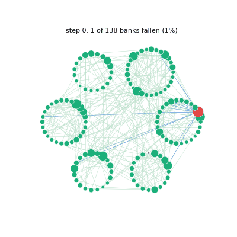

# netmotion

**Dynamics on complex networks in Python: growth, opinions, epidemics, immunisation and financial
contagion, and animations of all of them.**

[](https://pypi.org/project/netmotion/)
[](https://pypi.org/project/netmotion/)
[](https://github.com/marianotir/netmotion/actions/workflows/ci.yml)
[](https://github.com/marianotir/netmotion/blob/main/LICENSE)

<p align="center">
  
  <br><em>A bank fails and the failure travels through six countries: <code>animate_cascade</code>.</em>
</p>

`netmotion` builds complex networks and runs processes on them: opinions that spread and settle,
infections and how fast they travel, which nodes to immunise, and how the failure of one bank
brings down others. Every model is the one described in the book *Networks in Motion: Structure,
Propagation and Contagion in Complex Systems* (Mariano Tirado, 2026), and every figure of the book
is drawn by this package.

## Install

```bash
pip install netmotion
```

Python 3.11 or later. It needs only NumPy, NetworkX and Matplotlib.

## What is inside

| Module | What it does |
|---|---|
| `netmotion.networks` | random graphs (Erdős–Rényi), small worlds (Watts–Strogatz, Newman–Watts), scale-free growth (Barabási–Albert), networks of communities |
| `netmotion.metrics` | distances, degree distributions, clustering, the degree of order *n* K(n), central and vulnerable nodes |
| `netmotion.dynamics` | Hopfield dynamics, opinion networks with seven kinds of node, opinions on weighted networks |
| `netmotion.propagation` | infections and their speed α, clusters of order *n*, infection through places, immunisation |
| `netmotion.finance` | interbank debt networks, growth by strategies, bank-failure cascades |
| `netmotion.visualization` | drawings, charts and animations |

## Tutorial

Every function takes named parameters and a random seed, `rng`, so each example below prints the
same numbers every time. The same tutorial is a notebook:
[`examples/quickstart.ipynb`](https://github.com/marianotir/netmotion/blob/main/examples/quickstart.ipynb).

### 1. Build three networks

```python
from netmotion.networks import barabasi_albert, erdos_renyi, watts_strogatz

random_graph = erdos_renyi(n_nodes=200, link_probability=0.03, rng=1)
small_world = watts_strogatz(n_nodes=200, neighbours=6, rewiring_probability=0.05, rng=1)
scale_free = barabasi_albert(n_nodes=200, links_per_new_node=2, initial_nodes=3, rng=1)
```

### 2. Measure them

```python
from netmotion.metrics import clustering_coefficient, mean_degree, mean_distance, power_law_exponent

for name, g in [("random graph", random_graph), ("small world", small_world), ("scale free", scale_free)]:
    print(f"{name:13} <k> = {mean_degree(g):.2f}   L = {mean_distance(g):.2f}   C = {clustering_coefficient(g):.3f}")
print(f"scale free: P(k) ~ k^-{power_law_exponent(scale_free, min_degree=2):.2f}")
```

```
random graph  <k> = 5.76   L = 3.20   C = 0.031
small world   <k> = 6.00   L = 4.55   C = 0.464
scale free    <k> = 3.97   L = 3.73   C = 0.044
scale free: P(k) ~ k^-2.24
```

The small world keeps its clustering with short distances; the scale-free network's degrees fall
as a power law.

### 3. Opinions

Every node holds +1 (in favour) or −1 (against) and, at each step, takes the sign of the sum of its
neighbours' opinions.

```python
from netmotion.dynamics import random_initial_states, run_hopfield

start = random_initial_states(n_nodes=200, n_against=90, rng=2)   # 90 nodes start at -1
run = run_hopfield(small_world, start, steps=12)
print("in favour at each step:", run.n_plus.tolist())
```

```
in favour at each step: [110, 120, 128, 131, 130, 131, 131, 132, 132, 132, 132, 132, 132]
```

### 4. An infection

At each instant every infected node infects all its neighbours. The speed is the factor α of
p(t) = A₀e^(αt), fitted to the fraction of nodes infected.

```python
from netmotion.propagation import mean_propagation_speed, propagate, propagation_speed

infection = propagate(small_world, first_infected=0)
print(f"reaches everyone in {infection.steps} steps; alpha = {propagation_speed(infection.curve):.2f}")
print(f"mean alpha over every starting node: {mean_propagation_speed(small_world):.2f}")
```

```
reaches everyone in 7 steps; alpha = 0.73
mean alpha over every starting node: 0.71
```

### 5. Which nodes matter

The degree of order *n*, K(n), counts the links a node reaches within *n* steps, not only its own.

```python
from netmotion.metrics import central_node, k_order, k_order_ranking

print("K(2) of node 0:", k_order(scale_free, node=0, order=2))
print("top five by K(2):", k_order_ranking(scale_free, order=2)[:5])
print("central node:", central_node(scale_free))
```

```
K(2) of node 0: 82
top five by K(2): [15, 1, 6, 0, 4]
central node: 0
```

### 6. Immunise

Make the top nodes by K(2) immune, two at a time, and the infection slows down.

```python
from netmotion.propagation import immunisation_sweep

sweep = immunisation_sweep(scale_free, criterion="k_order_n", order=2, counts=range(0, 21, 2), rng=3)
for immune, alpha in zip(sweep.counts, sweep.speed):
    print(f"{immune:3} immune nodes -> mean alpha {alpha:.3f}")
print(f"beta = {sweep.beta:.3f}")
```

```
  0 immune nodes -> mean alpha 1.418
  2 immune nodes -> mean alpha 1.373
  ...
 20 immune nodes -> mean alpha 0.971
beta = -0.019
```

### 7. A banking crisis

Six countries grow bank by bank with seven strategies; the links are loans. Then the largest bank
fails. Each bank keeps reserves (here 20% of its balance) and calls in its loans once it has lost
30% of its capital.

```python
from netmotion.finance import InterbankNetwork, bank_capital, four_state_cascade, strategy_growth

grown, strategies = strategy_growth(n_communities=6, steps=120, rng=7)   # 6 countries
banks = InterbankNetwork.from_community_network(grown)
crash = four_state_cascade(banks.network, banks.largest_bank(), bank_capital(banks.network),
                           reserves=20.0, reaction_threshold=30.0)
print(f"{banks.n_banks} banks, {len(banks.too_big_to_fail())} too big to fail")
print(f"the largest fails: {crash.crashed_fraction:.0%} of the banks fall in {crash.steps} steps")
```

```
138 banks, 8 too big to fail
the largest fails: 85% of the banks fall in 11 steps
```

### 8. Watch it

```python
from netmotion.visualization import animate_cascade, save_animation, to_html

to_html(animate_cascade(banks, crash))                              # in a notebook: a player
save_animation(animate_cascade(banks, crash), "cascade.gif", fps=2)   # or a GIF, MP4 or HTML file
```

| Function | What it shows |
|---|---|
| `animate_growth(network)` | a network growing node by node, each node sized by its degree |
| `animate_propagation(network, first_infected)` | an infection spreading instant by instant |
| `animate_states(network, run)` | a Hopfield or opinion run, +1 blue and −1 red |
| `animate_cascade(banks, run)` | a bank failure travelling through the countries |
| `animate_frames(network, colors)` | any process, given a colour for every node in every frame |

## Notebooks

- [`examples/quickstart.ipynb`](https://github.com/marianotir/netmotion/blob/main/examples/quickstart.ipynb): this tutorial.
- [`examples/animations.ipynb`](https://github.com/marianotir/netmotion/blob/main/examples/animations.ipynb): growth, infection, opinions and a crisis, animated, and an animation of your own.
- [networks-in-motion-tutorials](https://github.com/marianotir/networks-in-motion-tutorials): the book chapter by chapter, in 14 notebooks.

## Options as parameters

Where a model can be run in more than one way, the choice is a parameter:

```python
mean_distance(g, unreachable="zero")            # or "exclude", "largest_component"
clustering_coefficient(g, skip_low_degree=True)
watts_strogatz(n_nodes, neighbours, rewiring_probability, variant="thesis")  # or "standard"
```

Every scientific object also carries a machine-readable `source`, recording the section and page
it comes from, and any implementation choice it makes.

## The book's figures

Every figure of *Networks in Motion* is drawn by `netmotion.experiments`, from the fixed seed
20110930:

```bash
python -m netmotion.experiments.cli --list        # every figure, with its chapter
python -m netmotion.experiments.cli T47           # one figure, as PDF, SVG and PNG
python -m netmotion.experiments.cli --all --skip-slow
```

The figures are written to a `figures/` folder: in the current directory for an installed
package, at the top of the repository for a clone.

## Development

```bash
git clone https://github.com/marianotir/netmotion
cd netmotion
pip install -e ".[dev]"
pytest -m "not slow"   # unit, cross-validation and quick reproduction tests
pytest                 # everything, with the long reproduction runs
```

## Where the models come from

The models are those of the book *Networks in Motion: Structure, Propagation and Contagion in
Complex Systems* (Mariano Tirado, 2026; ISBN 979-8177613925), which is based on the author's
master's thesis *Dinámica y evolución de redes complejas* (UNED, 2011), and of his
article on the interbank model, M. Tirado, *Int. J. Mod. Phys. C* **23**, 1250058 (2012).

## Licence

MIT. See [`LICENSE`](https://github.com/marianotir/netmotion/blob/main/LICENSE).
